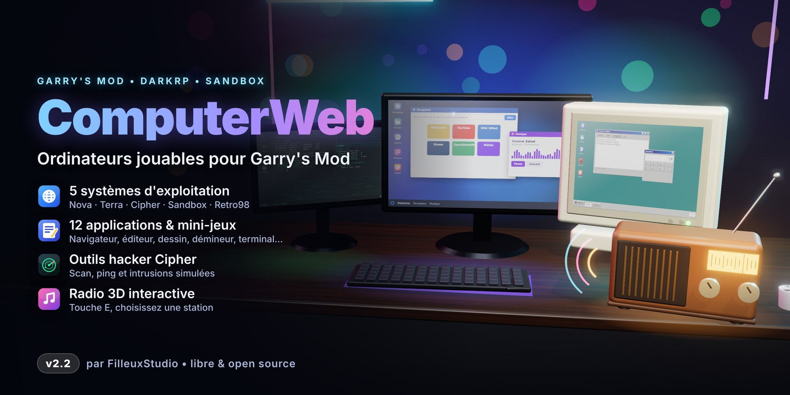
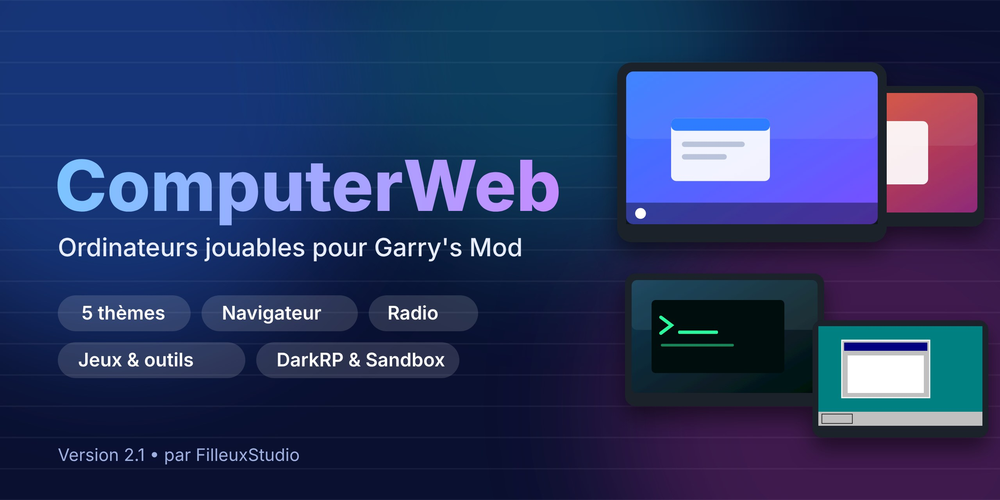
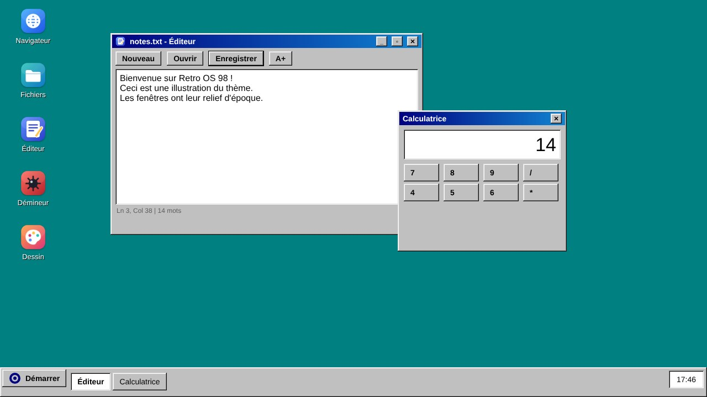

<p align="center"></p>

<p align="center">🇫🇷 Français · <a href="README.md">🇬🇧 English</a></p>

# ComputerWeb — Ordinateurs jouables pour Garry's Mod

Des ordinateurs et des écrans que les joueurs peuvent **vraiment utiliser** : un mini-système avec fenêtres, navigateur web, fichiers, bloc-notes, radio et terminal. Compatible **DarkRP**, Sandbox et tout serveur GMod 13.

> Version 2.2 — 5 « systèmes », 12 applications, outils d'ambiance **Cipher** et **radio 3D interactive**.

## Fonctionnalités

| | |
|---|---|
| 🖥️ **5 thèmes** | **Nova** (barre des tâches), **Terra** (dock latéral), **Cipher** (mode hacker), **Sandbox** (ardoise), **Retro98** (relief biseauté années 90) |
| 🎨 **Personnalisation** | Couleur d'accent au choix (en direct), fonds d'écran, raccourcis de bureau (application, site web ou fichier) avec icône à choisir |
| 🌐 **Navigateur** | Tuiles d'accueil, DuckDuckGo / Bing / Google, SafeSearch, garde d'URL |
| 📁 **Fichiers, Bloc-notes, Éditeur** | Dossiers et fichiers `.txt` par joueur (côté client). L'**Éditeur** ajoute rechercher/remplacer, taille de police, police fixe, ligne/colonne, nombre de mots |
| 🧮 **Calculatrice** | Évaluateur maison (aucun code exécuté) : `+ - * / ^ %`, parenthèses, `sqrt sin cos tan ln log abs round`, `pi`, `e` |
| 🎮 **Démineur & Dessin** | Démineur 3 niveaux (premier clic sûr) ; Dessin avec 12 couleurs, gomme, annuler, enregistrement dans Documents |
| 🎵 **Musique** | Radios (SomaFM), favoris, URL personnalisée |
| ⌨️ **Terminal** | `help ls cd cat mkdir touch rm mv echo open edit browse play stop start calc accent wallpaper theme neofetch ping…` |
| 📺 **Écrans 3D** | Page web sur le modèle, chargée seulement de près, volume selon la distance, `E` = télécommande |
| 🕶️ **Outils Cipher** | Application **Réseau** (scan, ping, ports, intrusion *simulée*), **Matrix**, commandes `scan` `ping` `ports` `hack`. Réservés au thème Cipher ; ils visent les ordinateurs, écrans et radios posés dans la scène |
| 📻 **Radio 3D** | Entité `cw_radio` : `E` pour choisir la station, couper, régler le volume ; son spatialisé, état partagé entre joueurs |
| ⚙️ **Paramètres** | Thème, fond d'écran, diagnostic du moteur web |

## Entités (menu `Q` → Entités → ComputerWeb)

`computerWindows` (Nova) · `computerUbuntu` (Terra) · `computerKali` (Cipher) · `computerGarrysMod` (Sandbox) · `computerRetro` (Retro98) · `cw_radio` (radio) · `monitorMusic` · `monitorMusciTwo`

Appuyez sur **E** sur un ordinateur pour ouvrir le bureau.

## Outils Cipher (ambiance, 100 % simulés)

Le système Cipher (entité `computerKali`, nom de classe gardé pour compatibilité) propose :

- **Réseau** (menu ou `start netlab`) : liste des machines proches, **Scanner**, **Ping**, **Ports**, **Intrusion (simulation)**.
- **Terminal** : `scan`, `ping <ip|nom|#n>`, `ports <cible>`, `hack <cible>`.
- **Matrix** : pluie de caractères en fond d'ambiance.

**Rien n'est réel** : aucune requête réseau n'est émise, les IP sont fictives (dérivées de l'index de l'entité) et la « faille » affichée est inventée. Pour votre scénario RP, écoutez `hook.Add("ComputerWeb_HackSimulated", "x", function(ply, ent) ... end)` (côté serveur, après validation de distance et délai de 8 s).

## Radio 3D

Posez `cw_radio` (modèle HL2 `citizenradio`, pas de modèle compilé sur mesure). **E** ouvre la télécommande : stations (config `Radios`), marche/arrêt, volume (`cw_radio_volume`, côté client). Le son est joué en 3D mono autour de la radio ; il ne démarre que lorsque vous êtes proche.

## Personnaliser son système

- **Paramètres → Couleurs** : 11 teintes prédéfinies ou curseurs rouge/vert/bleu ; appliqué immédiatement. Équivalent terminal : `accent 46 125 240` / `accent reset`.
- **Clic droit sur le bureau → Nouveau raccourci…** (ou **Paramètres → Bureau**) : choisissez application, site web ou fichier, un nom et une icône. Clic droit sur un raccourci pour le supprimer (40 maximum).
- Les réglages sont enregistrés sur le PC du joueur (`garrysmod/data/computerweb/`). Les sites passent toujours par la garde d'URL du serveur.

<p align="center"> <br><em>Illustrations (maquettes et rendu 3D, pas des captures du jeu).</em></p>

## Installation

- **Serveur / local** : copiez le dossier dans `garrysmod/addons/ComputerWeb/` (il doit contenir `addon.json` et `lua/`), puis redémarrez.
- **Workshop** : publiez avec `gmad` / `gmpublish` ; `addon.json` exclut déjà `docs`, `tests`, `tools` et les fichiers markdown.
- Pour **DarkRP** : aucune configuration, les entités sont spawnables par le menu `Q`. Pour les vendre, ajoutez-les dans votre `darkrp_customthings`.

## Configuration

Fichier `lua/computerweb/config.lua` (moteurs, tuiles, domaines, radios, préréglages d'écran) puis redémarrage. En direct, ConVars `cw_*` :

| ConVar | Défaut | Rôle |
|---|---|---|
| `cw_browser_enabled` | 1 | Active le navigateur |
| `cw_music_enabled` | 1 | Active la musique |
| `cw_safesearch` | 1 | Recherche protégée |
| `cw_url_filter` | 0 | 1 = liste blanche stricte |
| `cw_allowed_domains` | _vide_ | Domaines autorisés (virgules), remplace la config |
| `cw_block_private_hosts` | 1 | Refuse localhost et réseaux privés |
| `cw_use_distance` | 130 | Distance d'utilisation |
| `cw_session_distance` | 260 | Fermeture du bureau si on s'éloigne (0 = jamais) |
| `cw_screen_distance` | 700 | Distance de chargement d'un écran 3D |
| `cw_screen_custom_url` | 0 | 1 = URL libre sur écran 3D pour tous (sinon admins) |
| `cw_radio_volume` | 0.8 | Volume des radios 3D (client) |

Hook pour votre propre règle : `hook.Add("ComputerWeb_CanOpenURL", "x", function(url, host) ... end)`.
Commande superadmin : `cw_desktop` (ouvre le bureau sans ordinateur).

## Navigateur web : limites du moteur de GMod

Le moteur web de GMod dépend de la plateforme (Windows : CEF ; Linux/macOS : parfois Awesomium ou un CEF ancien). **YouTube et la vidéo mp4 ne marchent pas toujours en version de base**, d'où la présence de radios SomaFM (flux audio simples). Sous Linux/macOS, [GModPatchTool](https://github.com/solsticegamestudios/GModCEFCodecFix) met le moteur à jour et ajoute les codecs H.264/AAC. L'onglet **Paramètres → Diagnostic** indique ce que supporte votre client.

## Sécurité

Schémas dangereux refusés, réseaux privés bloqués, validations serveur (distance, cadence, plages) y compris pour la radio et les outils Cipher, aucun accès Lua depuis une page web. Voir `CHANGELOG.md`.

## Structure

```
lua/autorun/computerweb.lua   chargeur
lua/computerweb/              config, noyau, UI, OS, apps/
lua/entities/                 ordinateurs et écrans
materials/ sound/             assets originaux
tools/                        scripts de génération des assets (icônes, fonds, sons)
tests/                        tests Lua (python3 tests/run_tests.py)
```

Les tests (`pip install lupa`, 651 vérifications) valident la logique avec un faux environnement GMod ; ils ne remplacent pas un essai en jeu. À vérifier en jeu : le modèle et le son 3D de la radio, le rendu du relief Retro98.

## Crédits et licence

Par **FilleuxStudio**. Licence MIT (voir `LICENSE`). Tous les visuels et sons sont originaux ; la jaquette est un rendu 3D généré par script, pas une capture du jeu.
