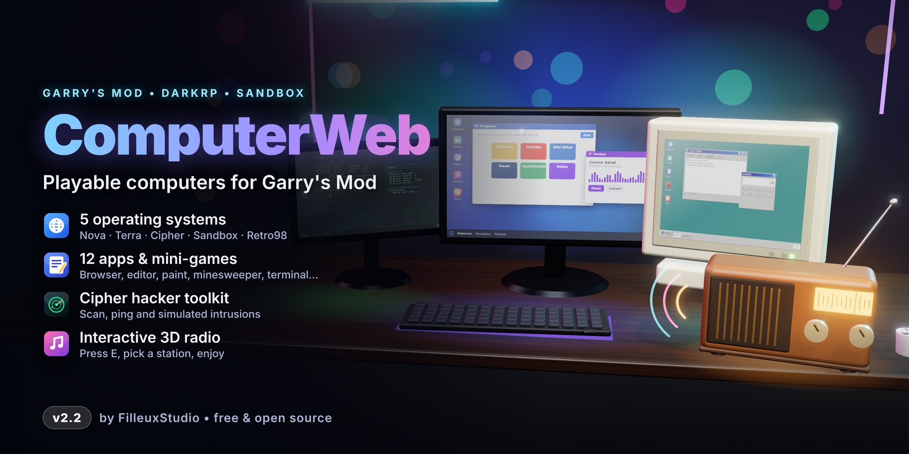
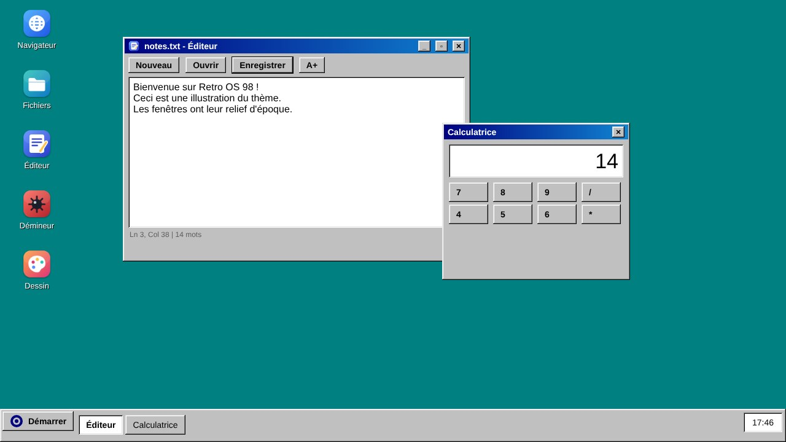

<p align="center"></p>

<p align="center"><a href="README.fr.md">🇫🇷 Français</a> · 🇬🇧 English</p>

# ComputerWeb — Playable computers for Garry's Mod

Computers and screens players can **actually use**: a mini operating system with windows, web browser, files, text editor, radio and terminal. Works with **DarkRP**, Sandbox and any GMod 13 server.

> Version 2.2 — 5 "systems", 12 apps, **Cipher** hacker-ambience tools and an **interactive 3D radio**.

## Features

| | |
|---|---|
| 🖥️ **5 themes** | **Nova** (taskbar), **Terra** (side dock), **Cipher** (hacker mode), **Sandbox** (slate), **Retro98** (bevelled 90s look) |
| 🎨 **Customisation** | Live accent colour, wallpapers, desktop shortcuts (app, website or file) with a chosen icon |
| 🌐 **Browser** | Home tiles, DuckDuckGo / Bing / Google, SafeSearch, URL guard |
| 📁 **Files, Notepad, Editor** | Per-player folders and `.txt` files (client side). The **Editor** adds find/replace, font size, monospace, line/column, word count |
| 🧮 **Calculator** | Home-made evaluator (no code executed): `+ - * / ^ %`, parentheses, `sqrt sin cos tan ln log abs round`, `pi`, `e` |
| 🎮 **Minesweeper & Paint** | 3 levels (safe first click); Paint with 12 colours, eraser, undo, saves into Documents |
| 🎵 **Music** | Radios (SomaFM), favourites, custom URL |
| ⌨️ **Terminal** | `help ls cd cat mkdir touch rm mv echo open edit browse play stop start calc accent wallpaper theme neofetch ping…` |
| 🕶️ **Cipher tools** | **Network** app (scan, ping, ports, *simulated* intrusion), **Matrix**, commands `scan` `ping` `ports` `hack`. Cipher theme only; they target computers, screens and radios placed in the world |
| 📻 **3D radio** | `cw_radio` entity: press `E` to pick a station, switch off, set volume; spatial sound, state shared between players |
| 📺 **3D screens** | Web page on the model, loaded only when close, distance-based volume, `E` = remote |
| ⚙️ **Settings** | Theme, wallpaper, web-engine diagnostics |

## Entities (`Q` menu → Entities → ComputerWeb)

`computerWindows` (Nova) · `computerUbuntu` (Terra) · `computerKali` (Cipher) · `computerGarrysMod` (Sandbox) · `computerRetro` (Retro98) · `cw_radio` (radio) · `monitorMusic` · `monitorMusciTwo`

Press **E** on a computer to open its desktop.

## Cipher tools (ambience only, 100 % simulated)

The Cipher system (entity `computerKali`; the class name is kept for compatibility) offers:

- **Network** app (menu or `start netlab`): nearby machines, **Scan**, **Ping**, **Ports**, **Intrusion (simulation)**.
- **Terminal**: `scan`, `ping <ip|name|#n>`, `ports <target>`, `hack <target>`.
- **Matrix**: falling-code background.

**Nothing is real**: no network request is sent, IPs are fictional (derived from the entity index) and the displayed "exploit" is made up. For roleplay scenarios, listen to `hook.Add("ComputerWeb_HackSimulated", "x", function(ply, ent) ... end)` (server side, after distance and 8 s cooldown checks).

## 3D radio

Spawn `cw_radio` (HL2 `citizenradio` model; no custom compiled model). **E** opens the remote: stations (`Radios` in the config), on/off, volume (`cw_radio_volume`, client side). Audio plays as 3D mono around the radio and only starts when you are nearby.

## Customising your system

- **Settings → Colours**: 11 presets or RGB sliders, applied instantly. Terminal: `accent 46 125 240` / `accent reset`.
- **Right-click desktop → New shortcut…** (or **Settings → Desktop**): pick an app, website or file, a name and an icon. Right-click a shortcut to delete it (max 40).
- Settings are stored on the player's PC (`garrysmod/data/computerweb/`). Websites always go through the server URL guard.

<p align="center"> <br><em>Illustrations (mock-ups and 3D render, not in-game screenshots).</em></p>

## Installation

- **Server / local**: copy the folder to `garrysmod/addons/ComputerWeb/` (it must contain `addon.json` and `lua/`), then restart.
- **Workshop**: publish with `gmad` / `gmpublish`; `addon.json` already excludes `docs`, `tests`, `tools` and markdown files.
- **DarkRP**: no setup needed, entities spawn from the `Q` menu. To sell them, add them to your `darkrp_customthings`.

## Configuration

File `lua/computerweb/config.lua` (engines, tiles, domains, radios, screen presets), then restart. Live `cw_*` ConVars:

| ConVar | Default | Purpose |
|---|---|---|
| `cw_browser_enabled` | 1 | Enable the browser |
| `cw_music_enabled` | 1 | Enable music |
| `cw_safesearch` | 1 | Safe search |
| `cw_url_filter` | 0 | 1 = strict allow-list |
| `cw_allowed_domains` | _empty_ | Allowed domains (comma separated), overrides config |
| `cw_block_private_hosts` | 1 | Refuse localhost and private networks |
| `cw_use_distance` | 130 | Use distance |
| `cw_session_distance` | 260 | Close desktop when walking away (0 = never) |
| `cw_screen_distance` | 700 | Load distance of a 3D screen |
| `cw_screen_custom_url` | 0 | 1 = anyone may enter a free URL on a 3D screen (otherwise admins) |
| `cw_radio_volume` | 0.8 | 3D radio volume (client) |

Custom rule hook: `hook.Add("ComputerWeb_CanOpenURL", "x", function(url, host) ... end)`.
Superadmin command: `cw_desktop` (opens the desktop without a computer).

## Web browser: GMod engine limits

GMod's web engine depends on the platform (Windows: CEF; Linux/macOS: sometimes Awesomium or an old CEF). **YouTube and mp4 video do not always work in the base game**, hence the SomaFM radios (plain audio streams). On Linux/macOS, [GModPatchTool](https://github.com/solsticegamestudios/GModCEFCodecFix) updates the engine and adds H.264/AAC codecs. **Settings → Diagnostics** shows what your client supports.

## Security

Dangerous schemes refused, private networks blocked, server-side validation (distance, rate, ranges) including for the radio and Cipher tools, no Lua access from web pages. See `CHANGELOG.md`.

## Structure

```
lua/autorun/computerweb.lua   loader
lua/computerweb/              config, core, UI, OS, apps/
lua/entities/                 computers, screens, radio
materials/ sound/             original assets
tools/                        asset generation scripts (icons, wallpapers, sounds)
tests/                        Lua tests (python3 tests/run_tests.py)
```

Tests (`pip install lupa`, 651 checks) validate logic against a fake GMod environment; they do not replace in-game testing. Worth checking in game: the radio model and 3D sound, Retro98 bevel rendering.

## Credits and licence

By **FilleuxStudio**. MIT licence (see `LICENSE`). All visuals and sounds are original; the cover is a script-generated 3D render, not a game screenshot.
