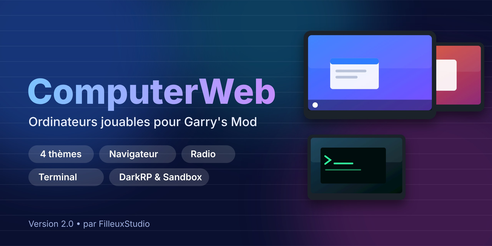

<p align="center"></p>

# ComputerWeb — Ordinateurs jouables pour Garry's Mod

Des ordinateurs et des écrans que les joueurs peuvent **vraiment utiliser** : un mini-système avec fenêtres, navigateur web, fichiers, bloc-notes, radio et terminal. Compatible **DarkRP**, Sandbox et tout serveur GMod 13.

> Version 2.0 — refonte complète du vieil addon `AddonsGmod13WebComputer`.

## Fonctionnalités

| | |
|---|---|
| 🖥️ **4 thèmes** | **Nova** (barre des tâches), **Terra** (dock latéral), **Cipher** (mode hacker), **Sandbox** (ardoise) |
| 🌐 **Navigateur** | Tuiles d'accueil, DuckDuckGo / Bing / Google, SafeSearch, garde d'URL |
| 📁 **Fichiers & Bloc-notes** | Dossiers et fichiers `.txt` enregistrés par joueur (côté client) |
| 🎵 **Musique** | Radios (SomaFM), favoris, URL personnalisée |
| ⌨️ **Terminal** | `help ls cd cat mkdir touch rm mv echo open browse play stop wallpaper theme neofetch ping…` |
| 📺 **Écrans 3D** | Page web sur le modèle, chargée seulement de près, volume selon la distance, `E` = télécommande |
| ⚙️ **Paramètres** | Thème, fond d'écran, diagnostic du moteur web |

## Entités (menu `Q` → Entités → ComputerWeb)

`computerWindows` (Nova) · `computerUbuntu` (Terra) · `computerKali` (Cipher) · `computerGarrysMod` (Sandbox) · `monitorMusic` · `monitorMusciTwo`

Appuyez sur **E** sur un ordinateur pour ouvrir le bureau.

## Installation

- **Serveur / local** : copiez le dossier dans `garrysmod/addons/ComputerWeb/` (il doit contenir `addon.json` et `lua/`), puis redémarrez.
- **Workshop** : publiez avec `gmad` / `gmpublish` ; `addon.json` exclut déjà `docs`, `tests`, `tools` et les fichiers markdown.
- Pour **DarkRP** : aucune configuration, les entités sont spawnables par le menu `Q`. Pour les vendre, ajoutez-les dans votre `darkrp_customthings`.

## Configuration

Fichier `lua/computerweb/config.lua` (moteurs, tuiles, domaines, radios, préréglages d'écran) puis redémarrage. En direct, ConVars `cw_*` :

| ConVar | Défaut | Rôle |
|---|---|---|
| `cw_browser_enabled` | 1 | Active le navigateur |
| `cw_music_enabled` | 1 | Active la musique |
| `cw_safesearch` | 1 | Recherche protégée |
| `cw_url_filter` | 0 | 1 = liste blanche stricte |
| `cw_allowed_domains` | _vide_ | Domaines autorisés (virgules), remplace la config |
| `cw_block_private_hosts` | 1 | Refuse localhost et réseaux privés |
| `cw_use_distance` | 130 | Distance d'utilisation |
| `cw_session_distance` | 260 | Fermeture du bureau si on s'éloigne (0 = jamais) |
| `cw_screen_distance` | 700 | Distance de chargement d'un écran 3D |
| `cw_screen_custom_url` | 0 | 1 = URL libre sur écran 3D pour tous (sinon admins) |

Hook pour votre propre règle : `hook.Add("ComputerWeb_CanOpenURL", "x", function(url, host) ... end)`.
Commande superadmin : `cw_desktop` (ouvre le bureau sans ordinateur).

## Navigateur web : limites du moteur de GMod

Le moteur web de GMod dépend de la plateforme (Windows : CEF ; Linux/macOS : parfois Awesomium ou un CEF ancien). **YouTube et la vidéo mp4 ne marchent pas toujours en version de base**, d'où la présence de radios SomaFM (flux audio simples). Sous Linux/macOS, [GModPatchTool](https://github.com/solsticegamestudios/GModCEFCodecFix) met le moteur à jour et ajoute les codecs H.264/AAC. L'onglet **Paramètres → Diagnostic** indique ce que supporte votre client.

## Sécurité

Schémas dangereux refusés, réseaux privés bloqués, validations serveur, anti-spam, aucun accès Lua depuis une page web. Voir `CHANGELOG.md`.

## Structure

```
lua/autorun/computerweb.lua   chargeur
lua/computerweb/              config, noyau, UI, OS, apps/
lua/entities/                 ordinateurs et écrans
materials/ sound/             assets originaux
tools/                        scripts de génération des assets
tests/                        tests Lua (python3 tests/run_tests.py)
```

Les tests (`pip install lupa`) valident la logique avec un faux environnement GMod ; ils ne remplacent pas un essai en jeu.

## Crédits et licence

Par **FilleuxStudio**. Licence MIT (voir `LICENSE`). Tous les visuels et sons de la v2 sont originaux.
